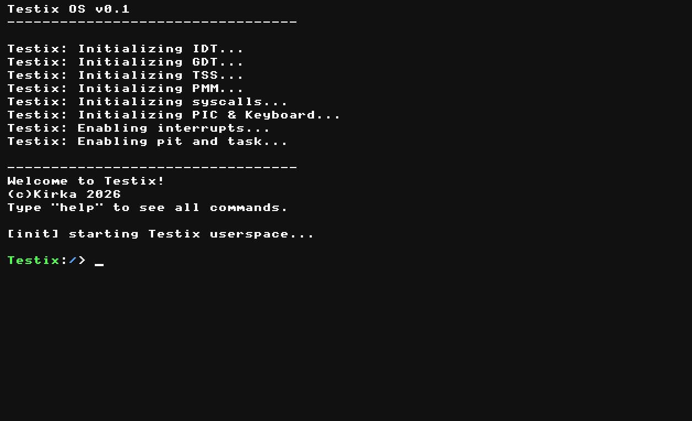

<div align="center">

# Testix OS

учебная 64-битная операционная система для архитектуры `x86_64`, написанная с нуля на freestanding C++20 и NASM с использованием загрузчика [Limine](https://limine-bootloader.org).

[](https://en.wikipedia.org/wiki/C%2B%2B)
[](https://en.wikipedia.org/wiki/X86-64)
[](LICENSE)



Система поддерживает загрузку в режимах **UEFI** и **Legacy BIOS**, вытесняющую многозадачность с изоляцией адресных пространств (Paging + HHDM), системные вызовы (`int 0x80`), интерактивный шелл в пространстве пользователя (**Ring 3**) и встроенный скриптовый язык **kernlang**.

</div>

---

## Возможности и архитектура

* **Загрузка и карта памяти:**
  * Протокол **Limine** (Higher Half Kernel по виртуальному адресу `0xffffffff80000000`, физическая загрузка `0x200000`).
  * **PMM (Physical Memory Manager):** битовый аллокатор страниц (4 КБ) с разбором карты памяти UEFI/Limine и резервированием системных областей.
  * **VMM (Virtual Memory Manager):** 4-уровневая страничная адресация (`PML4` → `PDPT` → `PD` → `PT`), изолированные адресные пространства для каждого процесса в Ring 3 и поддержка HHDM (Higher Half Direct Map).
* **Прерывания и защита:**
  * Настроенные **GDT**, **IDT** (исключения CPU `0..31`, аппаратные прерывания `IRQ 0..15`, программный шлюз `0x80` с `DPL=3`) и **TSS** (переключение стека ядра `rsp0` при переходе Ring 3 → Ring 0).
  * Программируемый таймер **PIT** (100 Гц) и контроллер прерываний **PIC 8259**.
* **Многозадачность и Userspace (Ring 3):**
  * Вытесняющий Round-Robin планировщик с поддержкой кооперативного переключения (`sys_yield`).
  * Загрузчик плоских бинарников (`kernel/loader`), размещающий код программ по адресу `0x400000` и стек по `0x7FFF0000`.
  * Интерактивный шелл (`user/shell.cpp`) и интерпретатор скриптов (`user/kernlang.hpp`) полностью вынесены в **Ring 3**.
* **Драйверы:**
  * Линейный **Framebuffer** (поддержка 32/24/16 bpp, программное отсечение границ экрана) и адаптивная консоль с масштабированием шрифта `8x8` под разрешение монитора.
  * Контроллер клавиатуры **PS/2** с поддержкой `Shift` и кольцевым буфером.
  * Последовательный порт **COM1 (`0x3F8`)** для отладочного вывода.

---

## Структура проекта

```
Testix/
├── kernel/                 # Ядро x86_64 (Higher Half)
│   ├── arch/x86_64/        # Точка входа, GDT, IDT, TSS, PIC, 4-уровневый Paging
│   ├── drivers/            # Модульные драйверы (VFS/tar, клавиатура, COM-порт, консоль, фреймбуфер)
│   ├── include/            # Заголовочные файлы ядра и протокол Limine
│   ├── loader/             # Загрузчик программ в Ring 3 и передача аргументов командной строки
│   ├── mm/                 # Менеджер физической памяти (PMM)
│   ├── panic/              # Обработчик и экран Kernel Panic
│   ├── syscall/            # Диспетчер системных вызовов (int 0x80)
│   ├── task/               # Вытесняющий планировщик задач (Ring 0 / Ring 3)
│   ├── timer/              # Программируемый таймер интервалов (PIT)
│   ├── linker.ld           # Линкер-скрипт ядра
│   └── main.cpp            # Главная функция инициализации ядра (kmain)
├── libsys/                 # SDK-библиотека для пользовательского пространства (Ring 3)
│   ├── include/            # Обёртки системных вызовов, работа со строками/путями и kernlang
│   └── user.ld             # Линкер-скрипт пользовательских программ (база 0x400000)
├── init/                   # Первый процесс PID 2 (запуск и авто-перезапуск shell)
├── shell/                  # Интерактивная командная оболочка Ring 3 (cd, help, запуск утилит)
├── binutils/               # Внешние системные утилиты (ls, cat, echo, edit, rm, man, uname, kernlang)
├── initrd/                 # Шаблон начальной файловой системы (упаковывается в initrd.tar)
│   ├── bin/                # Скомпилированные исполняемые файлы Ring 3
│   ├── etc/man/            # Страницы системного руководства (man-*)
│   ├── demo.kl             # Пример скрипта на языке kernlang
│   └── readme.txt          # Приветственный файл в VFS
├── pictures/               # Скриншоты системы для документации
├── limine.conf             # Конфигурация загрузчика Limine
└── makefile                # Система сборки (сборка ISO для UEFI и BIOS)
```

---

## Системные вызовы (ABI `int 0x80`)

Номер системного вызова передаётся в регистре `RAX`, первый аргумент — в `RDI`, возвращаемое значение — в `RAX`.

| `RAX` | Название | Аргументы | Описание |
| :---: | :--- | :--- | :--- |
| `1` | `sys_putchar` | `RDI = char c` | Вывод одного символа в консоль |
| `2` | `sys_yield` | — | Добровольная передача кванта времени следующей задаче |
| `3` | `sys_exit` | — | Завершение текущей пользовательской задачи |
| `4` | `sys_getchar` | — | Неблокирующее чтение символа из буфера клавиатуры (`0`, если пусто) |
| `5` | `sys_clear` | — | Очистка экрана консоли |
| `6` | `sys_spawn` | `RDI = uint64_t id` | Запуск встроенной программы (`1` — `prog_a`, `2` — `prog_b`) |
| `7` | `sys_panic` | — | Вызов тестового Kernel Panic из Ring 3 |
| `8` | `sys_active_tasks` | — | Возвращает количество активных задач в Ring 3 |

---

## Команды шелла (`Ring 3 Shell`)

После загрузки ядро запускает `user/shell.cpp` в пользовательском режиме:

* `help` — список доступных команд.
* `clear` — очистить экран.
* `uname` — информация о версии системы.
* `ring3` — параллельный запуск двух пользовательских процессов (`prog_a` и `prog_b`) с демонстрацией вытесняющей и кооперативной многозадачности.
* `edit` — вход в построчный редактор скриптов (`.save` — сохранить, `.cancel` — отменить).
* `list` — показать сохранённый скрипт.
* `run` — выполнить сохранённый скрипт на языке **kernlang**.
* `del` — удалить скрипт из буфера.
* `panictest` — проверка экрана Kernel Panic.

---

## Язык скриптов `kernlang`

Встроенный в шелл интерпретатор поддерживает переменные, вывод строк и задержки:

```text
# Пример скрипта kernlang
var os = Testix
var ver = 0.1
print "Running " os " v" ver
sleep 5
print "Done!"
```

**Правила синтаксиса:**
* Вокруг знака `=` обязательны пробелы (`var NAME = VALUE`).
* Для подстановки переменной в `print` или `var` используется префикс `$` без кавычек (`print $os`).
* Строки с пробелами заключаются в двойные кавычки (`"Hello world"`).

---

## Сборка и запуск

`makefile` автоматически определяет ОС (`Arch Linux`, `Debian/Ubuntu`, `macOS`) и подбирает нужный кросс-компилятор и пути к прошивкам UEFI (`OVMF`).

### Зависимости

`makefile` автоматически определяет дистрибутив Linux или macOS, находит прошивки UEFI (`OVMF`) и при отсутствии системного пакета `limine` сам скачивает и собирает его в `build/limine`.

* **Arch Linux:**
  ```bash
  sudo pacman -S base-devel gcc nasm xorriso limine edk2-ovmf qemu-full
  ```
* **Ubuntu / Debian / Linux Mint:**
  ```bash
  sudo apt update
  sudo apt install build-essential g++ nasm xorriso ovmf qemu-system-x86 git
  ```
* **Fedora:**
  ```bash
  sudo dnf install gcc-c++ make nasm xorriso edk2-ovmf qemu-system-x86 git
  ```
* **openSUSE (Tumbleweed / Leap):**
  ```bash
  sudo zypper install gcc-c++ make nasm xorriso qemu-ovmf-x86_64 qemu-x86 git
  ```
* **macOS (Homebrew):**
  ```bash
  brew install x86_64-elf-gcc x86_64-elf-binutils nasm xorriso limine qemu
  ```


### Команды сборки

```bash
# Собрать загрузочный образ testix.iso
make

# Запустить в QEMU в режиме UEFI (рекомендуется)
make run-efi

# Запустить в QEMU в режиме Legacy BIOS
make run-bios

# Очистить артефакты сборки
make clean
```
